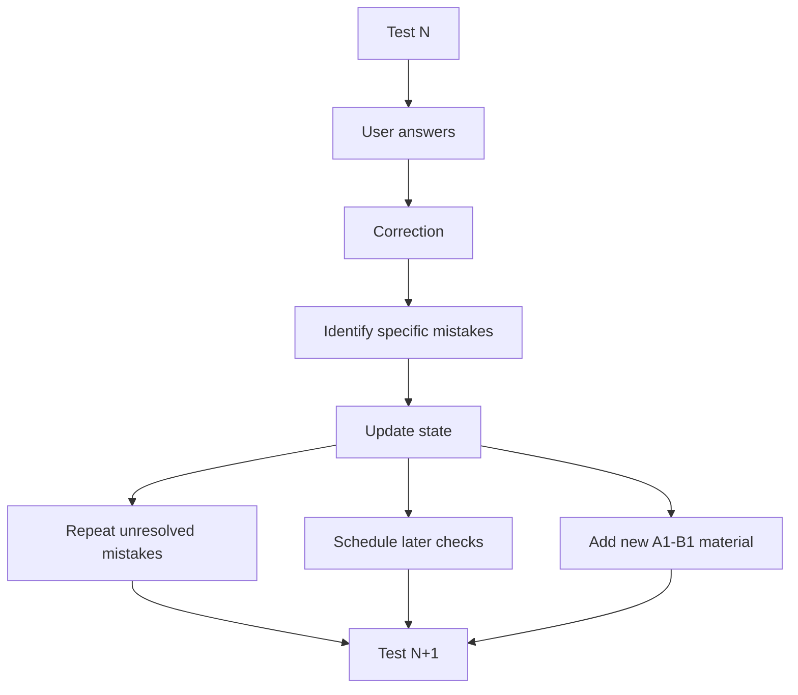

# llm-adaptive-learning-protocol

A structured prompt for German A1–B1 grammar and writing practice.

The prompt creates tests, checks the user's answers, records specific mistakes, repeats weak areas, and checks them again later with new examples.

## What this repository contains

This repository contains:

- the main prompt used to run the test system;
- short documentation explaining how the prompt works;
- example tests and example state data.

The project is intentionally kept simple. It is not an application and it does not contain a separate learning engine.

## What the prompt does

The prompt asks the language model to:

1. generate a German test;
2. evaluate the user's answers;
3. identify specific mistakes;
4. repeat unresolved mistakes in the next test;
5. check the same areas again later;
6. use different examples instead of repeating the same sentences;
7. keep already known A1/A2 material in occasional review while introducing B1 material.



The current test format contains 14 tasks with a maximum of 266 points.

## Example

A user writes:

```text
Ich helfe er.
```

The relevant error is the dative pronoun:

```text
er -> ihm
```

The prompt should not treat all personal pronouns or the whole dative case as unknown because of this single mistake.

The same area is checked again in a later test with a different sentence.

## Repository structure

```text
llm-adaptive-learning-protocol/
├── README.md
├── LICENSE
│
├── prompt/
│   ├── README.md
│   └── german-a1-b1.md
│
├── docs/
│   ├── README.md
│   ├── how-it-works.md
│   ├── rules.md
│   └── limitations.md
│
└── examples/
    ├── README.md
    ├── initial-test.pdf
    ├── next-test.pdf
    └── state-example.txt
```

## Current scope

The current prompt is for:

- German;
- levels A1 to B1;
- grammar;
- writing;
- repeated practice based on previous mistakes.

It is not intended to cover all parts of language learning or all parts of a B1 exam.

## Using the prompt

Open:

```text
prompt/german-a1-b1.md
```

Copy the complete prompt into a new chat with a language model.

Then send:

```text
NOVI INICIJALNI TEST
```

After completing the test, send the answers back in the same chat.

The prompt instructs the model to correct the test, update the recorded mistakes, and create the next test.

## Limitations

This repository does not claim that the method is scientifically validated.

It is not:

- an official TELC preparation system;
- a replacement for a teacher or course;
- a complete German-learning method;
- proof that a user will reach B1 faster;
- a deterministic software implementation.

Language models can misunderstand answers, apply rules inconsistently, or make factual and grammatical mistakes.

See `docs/limitations.md` for more detail.

## Why this exists

I created this prompt because randomly generated exercises were not useful enough for repeated grammar practice.

I wanted the next test to depend on previous mistakes instead of starting from scratch every time.

The main goal is simple:

- identify specific mistakes;
- repeat unresolved areas;
- check them again later;
- use new examples instead of repeating the same sentence.

The project started as a practical tool for my own German learning.
